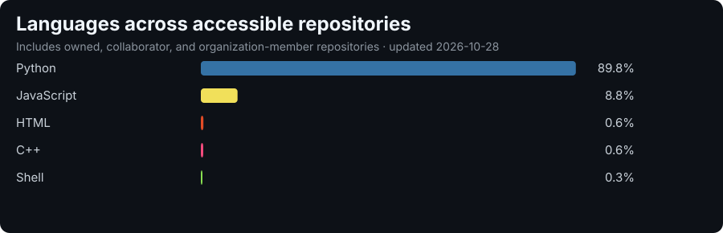

<h1 align="center">Hi, I'm David Govedarevic 👋</h1>

  <b>I build websites, web apps, mobile &amp; desktop apps, and automation tools for businesses and individuals.</b> 
  Software developer &amp; robotics engineer from Wiener Neustadt, Austria 🇦🇹

  
  
  

---

## 💼 What I can build for you

| Service | What you get |
|---|---|
| 🌐 **Websites** | Fast, modern landing pages and company websites, responsive on every device and deployed with HTTPS on your own domain. |
| ⚙️ **Web apps & dashboards** | Customer portals, admin dashboards, booking or ordering systems, and internal tools, with a Node.js backend and database when needed. |
| 📱 **Mobile & desktop apps** | Apps for **Android, iOS and Windows 11** from a single cross-platform codebase, for internal use or public release. |
| 🤖 **Automation & internal tools** | Python or C# scripts that take repetitive work off your hands: file handling, reports, data processing, and deployments. |
| 🛠️ **IT support** | Hardware, software, network and account setup, with documented fixes, for teams without a large IT department. |
| 🔬 **Technical prototypes** | Computer vision (YOLO / ONNX / OpenCV), Raspberry Pi and camera projects, and real-time and embedded software. |
| ✨ **Something else?** | Describe your idea. If it can be built, I'll build it. |

**Small jobs are welcome too.** One script, one fix, or one landing page is enough to get started.

---

## 🤝 How working with me works

1. **Tell me what you need.** A rough description is enough, through the [contact form on dgov.dev](https://dgov.dev) or by [email](mailto:davidgovedarevicit@gmail.com).
2. **Get an honest answer and a free quote.** You get a clear plan, with no commitment and no sales talk.
3. **I build it and keep you in the loop.** You see progress and give feedback along the way.
4. **Launch and handover.** The project is deployed and documented.

---

## 🏆 Why work with me

- **Proven under pressure.** My team won **1st place at ECER 2026** (European Conference on Educational Robotics) and **3rd place at GCER 2026**, the global Botball championship, in the top international bracket. That software had to work on the first try.
- **Real-world IT experience.** I did IT support at **Lindt & Sprüngli** production sites in Gloggnitz (2024) and Vienna-Hietzing (2025), including support for a production software stack.
- **Full stack, from hardware to UI.** I've trained and deployed a custom YOLOv8 vision model on a Raspberry Pi 3, written a robot software stack from scratch, and I'm currently co-developing a 3D RoboRacer simulator in NVIDIA Isaac Sim.
- **Direct communication.** You talk to the person who writes your code. There are no middlemen, and you can reach me in German or English.

---

## 🧰 Tech stack

**Languages** 

**Web, apps & infrastructure** 

**AI, vision & embedded** 

---

## 📊 Languages across my repositories

  

Generated weekly from GitHub's Languages API across every repository I own, collaborate on or contribute to through organizations, including private and team projects. Private repository names are never published.

---

## 📂 Selected work

- **[dgov.dev](https://dgov.dev)**: my portfolio and services site, available in six languages
- **Better Untis**: a timetable and school productivity tool
- **Autonomous drum detection**: a custom YOLOv8n model exported to ONNX, running in real time on a Raspberry Pi 3
- **Custom robot software stack**: an in-house replacement for the KIPR libwallaby libraries
- **RoboRacer 3D simulator** *(in progress)*: a realistic NVIDIA Isaac Sim simulator with a 14-DOF vehicle model

Many of my projects are private or team work, so this profile shows only part of what I build.

---

<h3 align="center">Have a project in mind? Let's talk. 🚀</h3>

  <a href="https://dgov.dev"><b>Request a free quote on dgov.dev</b></a> · <a href="mailto:davidgovedarevicit@gmail.com">davidgovedarevicit@gmail.com</a> · <a href="https://dgov.dev/David-Govedarevic-CV.pdf">Download CV</a>

<i>Based in Wiener Neustadt, Austria, and available for remote projects.</i>

